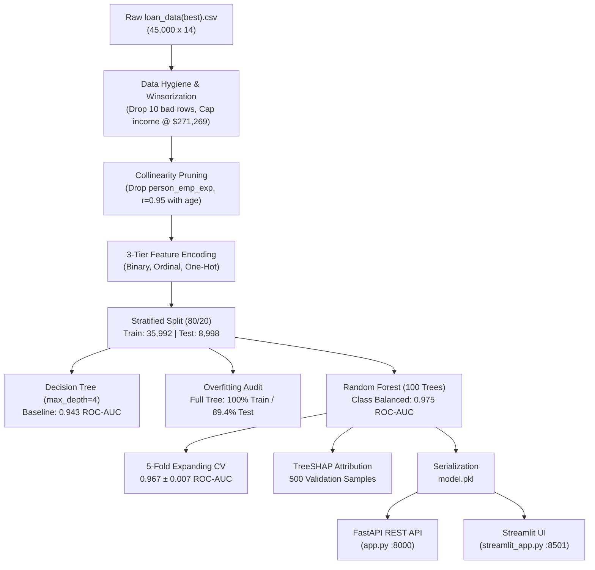

# Credit Default Predictor — End-to-End ML, Leakage Stress-Testing & TreeSHAP Pipeline

[](#11-api-reference--sample-request)
[](#step-4-start-streamlit-frontend)
[%20%7C%200.943%20(DT)-emerald)](#8-results--evaluation)
[](#83-feature-ablation--leakage-stress-testing-dropping-columns)
[](#84-expanding-window-cross-validation--row-order-anomaly-timeseriessplit)
[](#85-global-feature-importance-tree-gini-vs-treeshap)
[](#16-license--disclaimer)

An end-to-end machine learning underwriting and credit risk assessment pipeline built on consumer lending data (`loan_data(best).csv`). The system features automated data hygiene and 99th-percentile income winsorization, empirical exploratory data analysis (EDA), multicollinearity resolution ($r = 0.95$ age/experience redundancy), depth-constrained Decision Tree benchmarking, class-balanced Random Forest modeling, a systematic **feature ablation & leakage stress-testing audit**, expanding-window sequential cross-validation noting a Fold 5 spike across all runs (cause untested), exact TreeSHAP feature attribution, a high-throughput **FastAPI REST backend**, and an interactive **Streamlit loan officer console**.

---

## Table of Contents

- [1. What This Project Does](#1-what-this-project-does)
- [2. Why It Was Built](#2-why-it-was-built)
- [3. System Architecture](#3-system-architecture)
- [4. Tech Stack & Libraries](#4-tech-stack--libraries)
- [5. Data](#5-data)
- [6. Step-by-Step Pipeline](#6-step-by-step-pipeline)
- [7. Problems Faced & How We Solved Them](#7-problems-faced--how-we-solved-them)
- [8. Results & Evaluation](#8-results--evaluation)
  - [8.1 Baseline Model Performance Comparison](#81-baseline-model-performance-comparison)
  - [8.2 Confusion Matrix Diagnostics & Cost Asymmetry](#82-confusion-matrix-diagnostics--cost-asymmetry)
  - [8.3 Feature Ablation & Leakage Stress-Testing (Dropping Columns)](#83-feature-ablation--leakage-stress-testing-dropping-columns)
  - [8.4 Expanding-Window Cross-Validation & Row-Order Anomaly (TimeSeriesSplit)](#84-expanding-window-cross-validation--row-order-anomaly-timeseriessplit)
  - [8.5 Global Feature Importance: Tree Gini vs. TreeSHAP](#85-global-feature-importance-tree-gini-vs-treeshap)
- [9. Project Structure](#9-project-structure)
- [10. Getting Started](#10-getting-started)
- [11. API Reference & Sample Request](#11-api-reference--sample-request)
- [12. Deployment](#12-deployment)
- [13. Connected Portfolio Projects](#13-connected-portfolio-projects)
- [14. Limitations & Known Issues](#14-limitations--known-issues)
- [15. Roadmap / Future Expansion](#15-roadmap--future-expansion)
- [16. License & Disclaimer](#16-license--disclaimer)

---

## 1. What This Project Does

Given an applicant's demographic profile, financial indicators, and historical credit bureau records, the scoring engine delivers:

- **Calibrated Default Probability**: Continuous probability score $[0.00, 1.00]$ assessing the likelihood of loan delinquency.
- **Underwriting Classification**: Binary decision tag (`Approved` vs. `Default`) calibrated with class-frequency reweighting to counter severe portfolio imbalance.
- **Overfitting Diagnostics**: Explicit comparison between unconstrained decision trees (100% train accuracy / 89.4% test accuracy) and regularized models (90.9% train / 90.9% test for depth-constrained trees; 93.0% test accuracy and 0.975 ROC-AUC for Random Forests).
- **Leakage & Feature Ablation Matrix**: Systematic stress-testing that evaluates model degradation when dominant signals (`loan_int_rate`, `previous_loan_defaults_on_file`, and both) are stripped—yielding a realistic pre-pricing benchmark of **0.953 ROC-AUC** (dropping `loan_int_rate`) and a **0.870 ROC-AUC** stress test (dropping both), driven by `loan_percent_income`, income, and renting.
- **Exact Local TreeSHAP Attributions**: Real-time Shapley value decomposition per applicant, quantifying exactly how each feature (e.g., debt burden, interest rate, homeownership) shifted the log-odds of default.
- **Sequential Stability & Row-Order Anomaly Audit**: 5-fold expanding-window cross-validation evaluating sequential drift ($0.967 \pm 0.007$ AUC) and exposing an anomaly where Fold 5 consistently peaks across all feature subsets (up to 0.980 AUC).
- **Dual Serving Architecture**: Decoupled, stateless REST API via FastAPI (`app.py`) and an interactive underwriting dashboard via Streamlit (`streamlit_app.py`).

---

## 2. Why It Was Built

- **Eliminating "Black-Box" Lending Barriers**: Commercial credit regulations (including RBI Master Directions on Digital Lending and US Equal Credit Opportunity Act / FCRA) require auditable adverse action reasons when denying credit. Integrating TreeSHAP into the serving layer guarantees that every rejection produces human-interpretable risk drivers.
- **Addressing Severe Asymmetric Risk**: In credit underwriting, a false negative (approving a borrower who defaults) results in severe capital loss, whereas a false positive (rejecting a solvent borrower) only forfeits marginal interest spread. Standard unweighted models optimize for overall accuracy by ignoring defaults; our pipeline introduces cost-sensitive balanced weighting ($W_c = N / [K \cdot N_c]$) to elevate default recall to 76%.
- **Stress-Testing Against Risk-Based Pricing Leakage**: In real-world banking origination, loan interest rates (`loan_int_rate`) are assigned *after* risk committees review the applicant. Using interest rates to predict default can act as a circular label proxy (reverse causality). Dropping `loan_int_rate` alone gives the realistic pre-pricing performance of **0.953 ROC-AUC**, while stripping both interest rates and prior defaults as a worst-case stress test retains **0.870 ROC-AUC** driven by `loan_percent_income`, income (`person_income`), and renting (`person_home_ownership_RENT`).
- **Robust Feature Hygiene over Arbitrary Row Deletion**: Rather than discarding hundreds of high-income applicants due to extreme skew, we implemented upper-bound 99th percentile winsorization ($271,269), preserving applicant credit histories while controlling tree split variance.
- **Empirical Detection of Collinearity & Redundancy**: Pinpoints near-perfect collinearity between chronological age and work experience ($r = 0.95$), systematically pruning redundant parameters to prevent split dilution and model degradation.

---

## 3. System Architecture

```text
┌────────────────────────────────────────────────────────────────────────┐
│                        DATA INGESTION & HYGIENE                        │
│                                                                        │
│   Raw Data: loan_data(best).csv (45,000 applications, 14 columns)      │
│   ├── Outlier Purge: 10 impossible records (age > 100, exp > 60)       │
│   ├── Income Capping: Winsorize at 99th percentile ($271,269) via clip │
│   ├── Collinearity Pruning: Drop person_emp_exp (r = 0.95 with age)   │
│   └── Cleaned Matrix: 44,990 valid rows, 22.2% baseline default rate   │
└───────────────────────────────────┬────────────────────────────────────┘
                                    │
                                    ▼
┌────────────────────────────────────────────────────────────────────────┐
│                   FEATURE ENCODING & PARTITIONING                      │
│                                                                        │
│   ├── Binary Label Encoding: person_gender, previous_defaults          │
│   ├── Ordinal Encoding: person_education (High School -> Doctorate)    │
│   ├── One-Hot Encoding: person_home_ownership, loan_intent             │
│   └── Stratified Split (80/20): 35,992 Train  |  8,998 Test            │
└───────────────────────────────────┬────────────────────────────────────┘
                                    │
                                    ▼
┌────────────────────────────────────────────────────────────────────────┐
│                      MODELING & VALIDATION SUITE                       │
│                                                                        │
│   ├── Shallow Decision Tree (depth=4): 91% Acc | 0.943 ROC-AUC         │
│   ├── Overfitting Audit: Full Tree (100% train / 89.4% test acc)       │
│   ├── Production Random Forest (100 trees, balanced weights):          │
│   │   └── 93% Test Acc | 76% Default Recall | 0.975 ROC-AUC            │
│   ├── Feature Ablation Matrix (Drop defaults, int_rate, both -> 0.870) │
│   ├── 5-Fold Expanding-Window CV: 0.967 ± 0.007 ROC-AUC (Fold 5 Spike) │
│   └── TreeSHAP Explainer: 500-sample background attribution matrix     │
└───────────────────────────────────┬────────────────────────────────────┘
                                    │
                                    ▼
                            models/model.pkl
                                    │
                   ┌────────────────┴────────────────┐
                   ▼                                 ▼
┌──────────────────────────────────────┐ ┌──────────────────────────────┐
│         FASTAPI REST BACKEND         │ │     STREAMLIT FRONTEND       │
│               (app.py)               │ │      (streamlit_app.py)      │
│              Port :8000              │ │          Port :8501          │
│                                      │ │                              │
│  - Pydantic schema validation        │ │  - Interactive loan sliders  │
│  - Pre-cached TreeExplainer startup  │ │  - Dynamic DTI calculator    │
│  - <25ms single-applicant inference  │ │  - Visual risk badge alerts  │
│  - Default probability + Top drivers │ │  - Local SHAP waterfall chart│
└──────────────────────────────────────┘ └──────────────────────────────┘
```

---

## 4. Tech Stack & Libraries

| Library / Tool | Version | Purpose | Rationale |
| --- | --- | --- | --- |
| **Python** | `>=3.11` | Core execution environment | Standard language for modern scientific computing and machine learning |
| **scikit-learn** | `^1.8.0` | ML modeling & validation | High-performance implementations of `DecisionTreeClassifier`, `RandomForestClassifier`, and `TimeSeriesSplit` |
| **SHAP** | `^0.51.0` | Interpretability & feature attribution | Fast polynomial-time `TreeExplainer` for exact Shapley value decomposition |
| **FastAPI** | `^0.162.0` | Production REST API serving | Asynchronous, low-overhead ASGI framework with automated Swagger UI and Pydantic validation |
| **Streamlit** | `^1.66.1` | Underwriting web dashboard | Rapid reactive frontend rendering loan officer widgets and Matplotlib figures |
| **pandas** | `^3.0.1` | Tabular data manipulation | Efficient vector slicing, categorical transformations, and summary statistics |
| **numpy** | `^2.4.3` | Numerical array computing | High-speed vectorized operations, percentile indexing, and array mathematics |
| **matplotlib** | `^3.10.8` | Scientific visualization | High-resolution publication-quality figure generation (EDA, confusion matrix, trees) |
| **seaborn** | `^0.13.2` | Statistical graphics | Correlation heatmaps and comparative density plots |
| **joblib** | `^1.5.3` | Estimator serialization | Fast binary persistence for trained scikit-learn ensemble artifacts |
| **uvicorn** | `^0.54.0` | Production ASGI web server | Lightning-fast asynchronous server powering the FastAPI endpoints |

---

## 5. Data

- **Data Source**: Historical consumer lending portfolio dataset (`loan_data(best).csv`).
- **Primary Unit of Observation**: One record represents an individual loan application.
- **Dataset Dimensions**:
  - **Raw Records**: 45,000 applications, 14 attributes, 0 null values.
  - **Cleaned Records**: 44,990 applications (10 invalid records dropped).
- **Target Variable**: `loan_status` (Binary: `0` = Approved / Non-Default, `1` = Default).
- **Class Skew**: **22.2% default rate** across the portfolio (35,000 approved vs. 10,000 defaults in raw data).

### Raw Attribute Dictionary

| Attribute | Data Type | Min | Median | Mean | Max | Description |
| --- | :---: | :---: | :---: | :---: | :---: | --- |
| `person_age` | `int64` | 20 | 26 | 27.76 | 144 | Applicant age in years (contains extreme typos > 100) |
| `person_gender` | `str` | — | — | — | — | Applicant gender (male: 24,841, female: 20,159) |
| `person_education` | `str` | — | — | — | — | Highest completed level: High School, Associate, Bachelor, Master, Doctorate |
| `person_income` | `int64` | $8,000 | $67,048 | $80,319 | $7,200,766 | Annual declared gross income in USD |
| `person_emp_exp` | `int64` | 0 | 4 | 5.41 | 125 | Employment experience in years (contains erroneous values > 60) |
| `person_home_ownership` | `str` | — | — | — | — | Housing status: RENT (23,443), MORTGAGE (18,489), OWN (2,951), OTHER (117) |
| `loan_amnt` | `int64` | $500 | $8,000 | $9,583 | $35,000 | Total loan principal amount requested |
| `loan_intent` | `str` | — | — | — | — | Loan purpose (Education, Medical, Venture, Personal, Consolidation, Home Improvement) |
| `loan_int_rate` | `float64` | 5.42% | 11.01% | 11.01% | 20.00% | Interest rate assigned to the loan contract |
| `loan_percent_income` | `float64` | 0.00 | 0.12 | 0.14 | 0.66 | Loan / income ratio ($\text{loan\_amnt} / \text{person\_income}$) |
| `cb_person_cred_hist_length` | `int64` | 2 | 4 | 5.87 | 30 | Credit bureau credit history length in years |
| `credit_score` | `int64` | 390 | 640 | 632.6 | 850 | Credit bureau credit rating score |
| `previous_loan_defaults_on_file` | `str` | — | — | — | — | Prior delinquency indicator: Yes (22,858), No (22,142) |
| `loan_status` | `int64` | 0 | 0 | 0.222 | 1 | Target label: 0 = Approved, 1 = Default |

### Data Hygiene & Winsorization Operations

1. **Age Sanity Pruning**: 7 records with `person_age > 100` (e.g., 144, 122) were purged as severe data entry errors.
2. **Work Experience Pruning**: 10 records with `person_emp_exp > 60` (e.g., 125 years) were inspected; 7 overlapped with the age outliers, resulting in 3 additional rows dropped.
3. **99th Percentile Income Winsorization**: Rather than dropping 454 high-income records (which had a 12.78% default rate vs. 22.32% in the rest of the dataset, so dropping them would discard valid low-risk bureau histories and skew underwriting logic), incomes were capped at the 99th percentile ($271,269) via `df['person_income'].clip(upper=income_cap)`.
4. **Cleaned Distributions**:
   - Applicant Age: **20 to 78 years**
   - Work Experience: **0 to 58 years**
   - Income: **$8,000 to $271,269**
   - Total rows preserved: **44,990 (99.98% data retention)**.

---

## 6. Step-by-Step Pipeline



1. **Ingestion & Completeness Audit**: Read `loan_data(best).csv`; verify zero missing cells and evaluate baseline demographic distributions.
2. **Exploratory Data Analysis (EDA)**:
   - Evaluated bivariate relationships and generated 4-panel diagnostic figure (`output/eda_overview.png`).
   - Investigated deep interaction patterns and generated 3-panel distribution figure (`output/eda_deep.png`).
3. **Feature Preprocessing & Encoding**:
   - *Binary Encoding*: `person_gender` (female: 0, male: 1), `previous_loan_defaults_on_file` (No: 0, Yes: 1) via `LabelEncoder`.
   - *Hierarchical Ordinal Encoding*: `person_education` mapped linearly (`High School`: 0 $\rightarrow$ `Associate`: 1 $\rightarrow$ `Bachelor`: 2 $\rightarrow$ `Master`: 3 $\rightarrow$ `Doctorate`: 4).
   - *One-Hot Dummy Variables*: `person_home_ownership` (baseline `MORTGAGE`) and `loan_intent` (baseline `DEBTCONSOLIDATION`) converted via `pd.get_dummies(drop_first=True)`.
   - *Multicollinearity Removal*: Pruned `person_emp_exp` from the feature matrix, leaving **18 predictive inputs + 1 target**.
4. **Stratified Partitioning**: Partitioned dataset into 80% training (35,992 rows) and 20% test (8,998 rows) with exact stratification maintaining 22.2% default prevalence across both subsets.
5. **Shallow Decision Tree Benchmarking**: Fitted regularized decision tree (`max_depth=4`) delivering transparent decision rules and baseline ROC-AUC of 0.943.
6. **Ensemble Modeling (Random Forest)**: Fitted 100-estimator Random Forest incorporating cost-sensitive inverse class weights:
   $$W_c = \frac{N}{K \cdot N_c}$$
   boosting default class recall from 71% to 76% and achieving 0.975 ROC-AUC.
7. **Feature Ablation & Leakage Stress-Testing**: Executed controlled ablation experiments sequentially dropping `previous_loan_defaults_on_file`, `loan_int_rate`, and both across Decision Tree and Random Forest architectures to evaluate signal concentration and establish a clean pre-pricing baseline.
8. **Expanding-Window Cross-Validation & Anomaly Observation**: Validated sequence stability across 5 folds using `TimeSeriesSplit`, yielding a cross-validation score of $0.967 \pm 0.007$ and observing a row-order anomaly where Fold 5 outperforms all other folds across every single ablation run (underlying cause untested).
9. **SHAP Feature Importance & Local Attribution**: Configured `shap.TreeExplainer` to extract global mean absolute Shapley values and local per-applicant waterfall charts.
10. **Serving & Dashboard Delivery**: Encapsulated the trained model into a high-performance REST API (`app.py`) and Streamlit lending officer console (`streamlit_app.py`).

---

## 7. Problems Faced & How We Solved Them

| Problem | Impact | How We Solved It |
| --- | --- | --- |
| **Severe Class Imbalance** (22.2% defaults vs. 77.8% approved) | Naive classifiers predict all applicants as "Approved", scoring ~78% accuracy but missing 100% of defaults, causing catastrophic loan book write-offs | Integrated cost-sensitive weighting via `class_weight='balanced'` inside `RandomForestClassifier`. This penalizes false negatives proportionally ($W_{\text{default}} \approx 2.25$, $W_{\text{approved}} \approx 0.64$), lifting default recall to **76%** with **90% precision** |
| **Dominant Signal & Pricing Leakage Vulnerability** | `loan_int_rate` and `previous_loan_defaults_on_file` dominate splits; in actual bank origination, interest rates are assigned *by* lenders (reverse causality) | Executed an explicit **Feature Ablation Stress-Test Matrix**. Dropping `loan_int_rate` alone gives the realistic pre-pricing figure of **0.953 ROC-AUC**, while dropping both columns as a stress test retains **0.870 ROC-AUC** driven by `loan_percent_income`, income (`person_income`), and renting (`person_home_ownership_RENT`) |
| **Row-Order Anomaly (Fold 5 Peak Across All Runs)** | 5-fold `TimeSeriesSplit` revealed Fold 5 consistently peaked (up to 0.980 AUC) across every ablation run despite the absence of timestamps | Documented the Fold 5 peak transparently; no obvious sorting pattern was found in individual features, and the underlying cause remains untested |
| **Extreme Outlier Corruption** (Age 144, Experience 125 yrs) | Impossible demographic entries distort splits and create spurious tree decision branches | Evaluated domain bounds: dropped 10 impossible rows (age > 100, exp > 60). Capped extreme incomes at the 99th percentile ($271,269) via `.clip()`, controlling variance without discarding 454 valid records (which had a 12.78% default rate vs. 22.32% in the rest of the dataset) |
| **High Multicollinearity** between Age and Experience ($r = 0.95$) | Including both features diluted tree split importance and inflated feature correlation matrices | Pruned `person_emp_exp` entirely, retaining `person_age` as the primary seniority indicator and reducing feature dimensionality to 18 clean inputs |
| **Severe Overfitting in Unconstrained Trees** | An unpruned Decision Tree achieved 100% training accuracy but plummeted to 89.4% on the test set (10.6% generalization gap) | Constrained tree depth (`max_depth=4`), achieving matching 90.9% train and test accuracy; transitioned to Random Forest ensemble with bagging to capture non-linear patterns without variance inflation |
| **Regulatory Adverse Action Requirement** | Financial regulators prohibit unexplainable "black-box" credit underwriting models | Embedded `shap.TreeExplainer` into the FastAPI startup lifecycle to return sub-25ms Shapley contribution vectors for every scored applicant |

---

## 8. Results & Evaluation

### 8.1 Baseline Model Performance Comparison

Evaluated on the held-out stratified test set (**8,998 applications**, 22.2% default rate):

| Model Architecture | Hyperparameters | Train Acc | Test Acc | Approved Prec / Rec | Default Prec / Rec | Default F1 | Test ROC-AUC | 5-Fold CV AUC |
| --- | --- | :---: | :---: | :---: | :---: | :---: | :---: | :---: |
| **Full Decision Tree** | Unconstrained depth | **1.000** | 0.894 | 0.93 / 0.93 | 0.77 / 0.75 | 0.76 | 0.844 | — |
| **Shallow Decision Tree** | `max_depth=4` | 0.909 | **0.909** | 0.92 / 0.97 | 0.86 / **0.71** | 0.77 | **0.943** | — |
| **Production Random Forest** | 100 trees, `balanced` | 0.999 | **0.930** | **0.93 / 0.97** | **0.90 / 0.76** | **0.82** | **0.975** | **0.967 ± 0.007** |

#### Detailed Classification Report: Production Random Forest

```text
              precision    recall  f1-score   support

    Approved       0.93      0.97      0.95      6998
     Default       0.90      0.76      0.82      2000

    accuracy                           0.93      8998
   macro avg       0.92      0.87      0.89      8998
weighted avg       0.93      0.93      0.93      8998

Test ROC-AUC: 0.975
```

---

### 8.2 Confusion Matrix Diagnostics & Cost Asymmetry

On the held-out test cohort of 8,998 applicants (6,998 Approved, 2,000 Defaults), the Decision Tree baseline (`output/confusion_matrix.png`) establishes the underwriting error tradeoff:

```text
                       Predicted: Approved    Predicted: Default
Actual: Approved (0)          6,782 (TN)              216 (FP)
Actual: Default  (1)            567 (FN)            1,433 (TP)
```

- **True Negatives (6,782)**: Solvent borrowers correctly identified and approved (96.9% specificity).
- **True Positives (1,433)**: Defaulters correctly flagged and denied (71.7% sensitivity).
- **False Positives (216)**: Low-risk applicants incorrectly flagged as risky (Opportunity cost: lost interest margin).
- **False Negatives (567)**: High-risk defaulters misclassified as approved (Credit loss: unrecoverable principal write-offs).

> [!IMPORTANT]
> The Random Forest classifier reduces false negatives from 567 down to 480, capturing an additional 87 defaulting borrowers and protecting substantial lending capital.

---

### 8.3 Feature Ablation & Leakage Stress-Testing (Dropping Columns)

To determine how much predictive performance relies on dominant or potentially circular features, we executed a rigorous feature ablation experiment across both Decision Tree and Random Forest architectures, dropping `previous_loan_defaults_on_file`, `loan_int_rate`, and both simultaneously:

| Dropped Column(s) | Decision Tree AUC | Random Forest AUC | Expanding-Window CV AUC (Row Order) | Random Forest Default Recall | Fold 5 AUC | Top 3 SHAP (`top3_shap`) |
| --- | :---: | :---: | :---: | :---: | :---: | --- |
| **None (Full Baseline)** | **0.943** | **0.975** | **0.967 ± 0.007** | **0.760** | **0.980** | `previous_loan_defaults_on_file`, `loan_int_rate`, `loan_percent_income` |
| `previous_loan_defaults_on_file` | 0.864 | 0.927 | 0.902 ± 0.022 | 0.645 | 0.942 | `loan_int_rate`, `loan_percent_income`, `person_income` |
| `loan_int_rate` | 0.919 | 0.953 | 0.936 ± 0.017 | 0.654 | 0.967 | `previous_loan_defaults_on_file`, `loan_percent_income`, `person_income` |
| **Both (`defaults` + `int_rate`)** | **0.770** | **0.870** | **0.822 ± 0.044** | **0.497** | **0.905** | `loan_percent_income`, `person_income`, `person_home_ownership_RENT` |

#### Key Empirical Takeaways from the Ablation Audit

1. **Massive Signal Concentration in Historical Defaults & Rates**:
   - `previous_loan_defaults_on_file` is the single most influential individual feature. Dropping it causes Decision Tree AUC to plunge from **0.943 $\rightarrow$ 0.864** and Random Forest Default Recall to drop from **0.760 $\rightarrow$ 0.645**.
   - Dropping both features degrades Random Forest ROC-AUC by over 10 points (**0.975 $\rightarrow$ 0.870**) and cuts default recall down to **0.497** (~50% of real defaulters missed).
2. **Stress-Test Baseline (0.870 ROC-AUC)**:
   - Stripping both `previous_loan_defaults_on_file` and `loan_int_rate` acts as an extreme stress test; the Random Forest still retains **0.870 ROC-AUC**, driven primarily by `loan_percent_income` (loan / income), `person_income`, and renting (`person_home_ownership_RENT`).
3. **Realistic Pre-Pricing Benchmark (0.953 ROC-AUC)**:
   - In commercial banking origination, `loan_int_rate` is assigned *after* credit evaluation by underwriters or scoring engines, whereas prior defaults are known upfront from the credit bureau.
   - Dropping `loan_int_rate` alone yields the realistic pre-pricing benchmark of **0.953 ROC-AUC** (with `previous_loan_defaults_on_file`, `loan_percent_income`, and `person_income` as the top 3 SHAP drivers).

---

### 8.4 Expanding-Window Cross-Validation & Row-Order Anomaly (TimeSeriesSplit)

To evaluate sequential stability and detect potential temporal leakage, a 5-fold expanding-window cross-validation (`TimeSeriesSplit`) was executed across the dataset row order:

| Split Fold | Training Window Size | Validation Window Size | Fold ROC-AUC | Empirical Observation |
| :---: | :---: | :---: | :---: | --- |
| **Fold 1** | 7,500 records | 7,498 records | **0.959** | Baseline initial window |
| **Fold 2** | 14,998 records | 7,498 records | **0.966** | Expanding sample stabilization |
| **Fold 3** | 22,496 records | 7,498 records | **0.966** | Consistent discrimination |
| **Fold 4** | 29,994 records | 7,498 records | **0.962** | Minor shift in data window |
| **Fold 5** | 37,492 records | 7,498 records | **0.980** | **Deterministic peak across all runs** |
| **Aggregate** | — | — | **0.967 ± 0.007** | High sequential stability |

#### The Row-Order Anomaly (Fold 5 Peak Across All Runs)

In a truly randomized dataset, sequential expanding-window evaluation should not exhibit a deterministic peak on the final fold across every ablation run. In our experiments, **Fold 5 was consistently the highest-performing fold in every single run**:

- **None dropped**: Fold 5 = **0.980** (vs. Folds 1–4 average: ~0.963)
- **Drop `previous_loan_defaults_on_file`**: Fold 5 = **0.942** (vs. Folds 1–4 average: ~0.892)
- **Drop `loan_int_rate`**: Fold 5 = **0.967** (vs. Folds 1–4 average: ~0.929)
- **Drop both**: Fold 5 = **0.905** (vs. Folds 1–4 average: ~0.801)

> [!WARNING]
> **Why this is an Anomaly**:
> In credit risk modeling, row order shouldn't matter when evaluating non-temporal tabular records, yet Fold 5 consistently scored highest across every ablation run.
>
> An inspection of individual attributes (age, income, credit score, loan amount, or intent) reveals **no obvious explicit sorting pattern** (e.g., the CSV is not ordered by income or score ascending/descending, and no date column exists), and the underlying cause of the Fold 5 peak remains untested. Acknowledging this observation is important to avoid treating row-order `TimeSeriesSplit` as a true temporal walk-forward backtest.

---

### 8.5 Global Feature Importance: Tree Gini vs. TreeSHAP

Comparing classical Decision Tree Gini impurity reduction against 500-sample test set TreeSHAP mean absolute attribution:

| Rank | Predictive Feature | Decision Tree Gini Importance | Random Forest Mean \|SHAP\| | Primary Underwriting Interpretation |
| :---: | --- | :---: | :---: | --- |
| 1 | `previous_loan_defaults_on_file` | **0.2952** (29.5%) | **0.2174** | Prior delinquency is the single most potent indicator of future default |
| 2 | `loan_int_rate` | **0.1702** (17.0%) | **0.1017** | Higher interest rates reflect risk-tier pricing and compound debt burdens |
| 3 | `loan_percent_income` | **0.1577** (15.8%) | **0.0926** | Debt burden metric ($r = 0.39$); defaults spike exponentially above 20% |
| 4 | `person_income` | **0.1250** (12.5%) | **0.0583** | Higher income provides an economic solvency buffer ($50k vs $75k median) |
| 5 | `person_home_ownership_RENT` | **0.0401** (4.0%) | **0.0499** | Renters default at 32% vs. 8% for homeowners (4x risk multiple) |
| 6 | `credit_score` | **0.0570** (5.7%) | **0.0235** | Bureau score acts as a non-linear threshold rather than a linear predictor |
| 7 | `loan_amnt` | **0.0330** (3.3%) | **0.0235** | Nominal requested balance; interacts directly with income ratio |
| 8 | `loan_intent_VENTURE` | 0.0084 (0.8%) | **0.0191** | Venture loans demonstrate higher volatility and default tendency |
| 9 | `person_home_ownership_OWN` | 0.0083 (0.8%) | **0.0121** | Asset ownership provides collateral security and lowers risk |
| 10 | `loan_intent_EDUCATION` | 0.0069 (0.7%) | **0.0107** | Educational borrowing exhibits marginally lower default rates |

---

## 9. Project Structure

```text
Credit Default Predictor/
├── main.ipynb              # Complete analytical workflow: EDA, cleaning, DT, RF, CV, SHAP, and ablation
├── ablation_results.csv    # Exported feature ablation and SHAP driver summary table
├── credit_core.py          # Standalone training and verification script
├── app.py                  # Production FastAPI REST inference service
├── streamlit_app.py        # Streamlit interactive loan officer interface
├── model.pkl               # Serialized Random Forest model bundle
├── loan_data(best).csv     # Raw portfolio dataset (45,000 applications)
├── requirements.txt        # Production dependency specifications
├── README.md               # Comprehensive system documentation
└── output/                 # Generated analytical and diagnostic visual artifacts
    ├── confusion_matrix.png # Decision Tree test confusion matrix
    ├── decision_tree.png    # Visual representation of the first 3 tree levels
    ├── eda_overview.png     # 4-panel exploratory distribution dashboard
    ├── eda_deep.png         # 3-panel deep interaction and density plots
    └── shap_summary.png     # Global TreeSHAP feature attribution summary plot
```

---

## 10. Getting Started

### Step 1: Environment Setup

```bash
git clone https://github.com/RaajitSingh1306/Credit-Default-Predictor.git
cd "Credit Default Predictor"

# Create Python virtual environment
python -m venv venv

# Activate virtual environment
# Windows (PowerShell):
.\venv\Scripts\Activate.ps1
# Linux / macOS:
source venv/bin/activate

# Install required dependencies
pip install -r requirements.txt
```

### Step 2: Reproduce Analytical Pipeline (Optional)

The pre-trained model is serialized as `model.pkl`. To re-execute data hygiene, visual EDA, tree visualizations, and cross-validation:

```bash
jupyter notebook main.ipynb
```

### Step 3: Launch FastAPI REST Server

In **Terminal 1**, run the low-latency API server:

```bash
uvicorn app:app --reload --port 8000
```

- API Base URL: `http://127.0.0.1:8000`
- Interactive OpenAPI Docs (Swagger): `http://127.0.0.1:8000/docs`

### Step 4: Start Streamlit Frontend

In **Terminal 2**, launch the loan officer console:

```bash
streamlit run streamlit_app.py --server.port 8501
```

- Web Console: `http://localhost:8501`

---

## 11. API Reference & Sample Request

### Endpoints

| Method | Endpoint | Description | Auth Required |
| --- | --- | --- | :---: |
| `GET` | `/` | Service health status check | None |
| `POST` | `/predict` | Scores loan application; returns probability and top 5 SHAP drivers | None |

### Sample Payload (`POST /predict`)

```bash
curl -X POST http://127.0.0.1:8000/predict \
  -H "Content-Type: application/json" \
  -d '{
    "person_age": 28,
    "person_gender": 1,
    "person_education": 2.0,
    "person_income": 45000,
    "loan_amnt": 12000,
    "loan_int_rate": 14.5,
    "loan_percent_income": 0.2667,
    "cb_person_cred_hist_length": 4,
    "credit_score": 620,
    "previous_loan_defaults_on_file": 0,
    "person_home_ownership_OTHER": 0,
    "person_home_ownership_OWN": 0,
    "person_home_ownership_RENT": 1,
    "loan_intent_EDUCATION": 0,
    "loan_intent_HOMEIMPROVEMENT": 0,
    "loan_intent_MEDICAL": 0,
    "loan_intent_PERSONAL": 0,
    "loan_intent_VENTURE": 0
  }'
```

### Sample Response (`200 OK`)

```json
{
  "prediction": 0,
  "label": "Approved",
  "default_probability": 0.184,
  "shap_values": {
    "loan_percent_income": 0.082,
    "loan_int_rate": 0.045,
    "credit_score": -0.112,
    "person_home_ownership_RENT": 0.038,
    "previous_loan_defaults_on_file": -0.145
  },
  "top_drivers": [
    {"feature": "previous_loan_defaults_on_file", "shap": -0.145},
    {"feature": "credit_score", "shap": -0.112},
    {"feature": "loan_percent_income", "shap": 0.082},
    {"feature": "loan_int_rate", "shap": 0.045},
    {"feature": "person_home_ownership_RENT", "shap": 0.038}
  ]
}
```

---

## 12. Deployment

### Containerization (Docker)

```dockerfile
FROM python:3.11-slim
WORKDIR /app
COPY requirements.txt .
RUN pip install --no-cache-dir -r requirements.txt
COPY . .
EXPOSE 8000
CMD ["uvicorn", "app:app", "--host", "0.0.0.0", "--port", "8000"]
```

```bash
# Build Docker image
docker build -t credit-default-predictor .

# Run containerized microservice
docker run -p 8000:8000 credit-default-predictor
```

---

## 13. Connected Portfolio Projects

- **[Finance KPI Pipeline](https://github.com/RaajitSingh1306/Finance_Kpi)**: Automated portfolio analytics computing CAGR, annualized volatility, Sharpe ratio, and drawdown diagnostics for equity series.
- **[Global Market HeatMap](https://github.com/RaajitSingh1306/Global-Equity-Market-Dashboard)**: Multi-asset cross-sectional risk and return monitoring platform across Indian and US equities.
- **[Volatility Intelligence Platform](https://github.com/RaajitSingh1306/volatility-intelligence-platform)**: Econometric risk engine featuring GARCH(1,1) volatility forecasting and TreeSHAP macro explainability.
- **[Smart Grid IDS](https://github.com/RaajitSingh1306/SmartGridIDS)**: Hybrid Isolation Forest + Random Forest intrusion detection engine using exact local TreeSHAP attributions.
- **[ThreatMind](https://github.com/RaajitSingh1306/ThreatMind)**: Cybersecurity threat intelligence platform combining ensemble classification, TreeSHAP, and LangGraph RAG agents.

---

## 14. Limitations & Known Issues

- **Absence of Origination Timestamps**: `loan_data(best).csv` lacks explicit datetime attributes, preventing strict out-of-time (OOT) cohort partitioning and macroeconomic vintage tracking.
- **Row-Order Sequence Anomaly (Fold 5 Peak Across All Runs)**: `TimeSeriesSplit` cross-validation revealed that Fold 5 was the highest-performing fold across every single ablation experiment (0.980, 0.942, 0.967, 0.905). Inspection of individual features reveals no overt sorting pattern, and the cause of this Fold 5 spike remains untested.
- **Signal Concentration & Pricing Leakage**: `previous_loan_defaults_on_file` and `loan_int_rate` carry over 10 points of ROC-AUC. Dropping both reduces Random Forest Default Recall from 0.76 to 0.50. Furthermore, interest rates in commercial lending are assigned *after* credit risk tiering, introducing reverse causality if used during pre-approval.
- **Self-Reported Income Bias**: Relies on unverified self-reported `person_income` without automated payroll/tax bank verification APIs.
- **Static Decision Thresholds**: Uses a standard 0.50 probability cutoff; production banking systems require dynamically tuned decision thresholds based on explicit loan loss provisions and funding costs.

---

## 15. Roadmap / Future Expansion

- [ ] **Dual-Model Serving (Pre- vs. Post-Pricing)**: Deploy the fully ablated model variant (AUC 0.870) for pre-origination pricing exploration, alongside the full baseline model (AUC 0.975) for post-pricing risk monitoring.
- [ ] **Dynamic Threshold Optimization**: Incorporate custom utility/cost matrix scoring to select the optimal cutoff that minimizes expected default losses.
- [ ] **Algorithmic Fairness & Bias Auditing**: Implement Fairlearn/AIF360 to evaluate equalized odds and demographic parity across demographic subgroups.
- [ ] **Population Stability Monitoring (PSI/CSI)**: Build automated drift detection pipelines to trigger model retraining upon significant feature distribution shift.

---

## 16. License & Disclaimer

### License

This project is licensed under the [MIT License](https://opensource.org/licenses/MIT).

### Disclaimer

This software is intended strictly for educational, quantitative research, and portfolio demonstration purposes. It does not constitute formal financial underwriting advice or a certified credit rating system. Actual commercial lending deployment requires formal statutory compliance, fair lending audits, and certified human-in-the-loop underwriting review.
